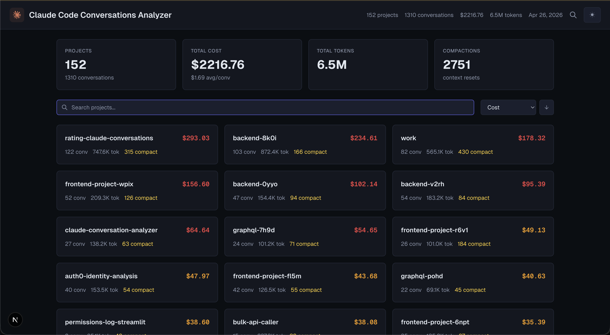
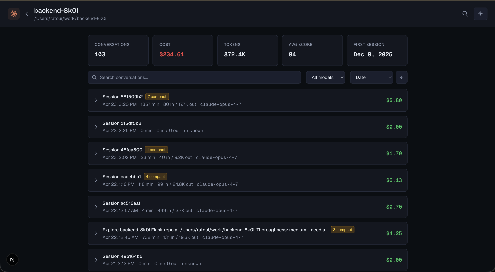
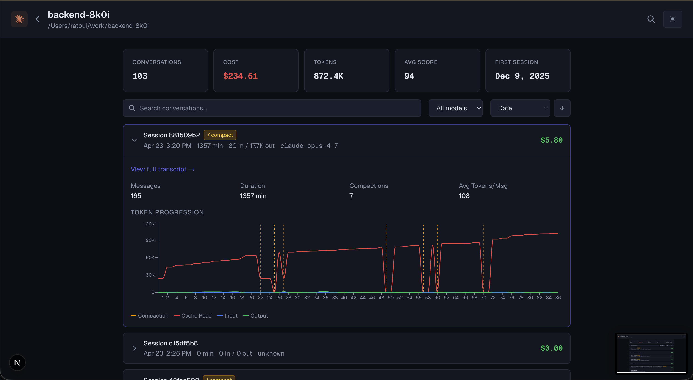
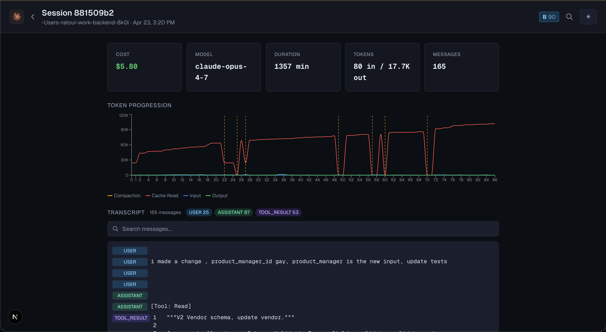
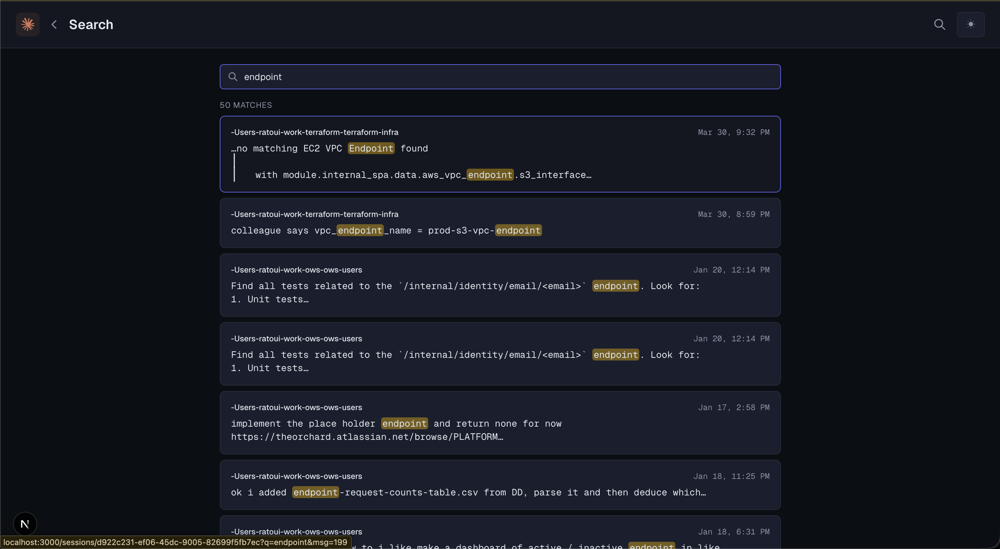

# Claude Code Conversation Analyzer

A self-hosted dashboard for understanding how you actually use [Claude Code](https://claude.com/product/claude-code): which projects you spend the most time on, where the cost goes, which conversations are healthy, and which ones spiraled into a long, expensive mess.

  

## Why I built this

I wanted to actually see my own data. Claude Code stores every conversation locally in `~/.claude/projects/`, but there's no built-in way to browse it. I wanted to:

- Keep a full history of every conversation, indefinitely.
- See how much I'm spending — total, per project, and grouped across related projects (e.g. all the repos in one product area).
- Search across older conversations to find something I worked on weeks or months ago.

This dashboard reads the history that's already on disk, augments it with cost and quality data, and gives me a place to actually look at it. Everything runs locally — no data leaves your machine.

## Screenshots

**Project overview** — every project ranked by cost, with conversation count, total tokens, and compaction count at a glance.



**Project detail** — every session in a project, sortable by date or cost, with per-session model and token breakdown.



**Token progression** — expand any session to see token usage over time, with compaction events marked. Useful for spotting where a conversation went off the rails.



**Session detail** — full transcript with role filtering and message search, alongside the same token chart and cost summary.



**Cross-project search** — full-text search across every message in every project, jumping straight to the relevant session.



## Features

- **Project overview** — Grade distribution (A–F), total cost, message volume per project. Search and sort across all projects.
- **Conversation detail** — Per-session token chart with compaction events marked, full message transcript, cost breakdown by model.
- **Quality scoring** — Conversations are graded on cache usage, length, query specificity, context utilization, and prompt efficiency. Weighted toward what actually drives cost (cache reads, length).
- **Cross-session search** — Full-text search across every message in every project.
- **Local-first** — All data lives in a SQLite database on your machine. Nothing is uploaded.

## Setup matters: enable long retention first

> **Do this before anything else.** Claude Code prunes conversation history after a short default window. To analyze trends over time, set a long retention period in `~/.claude/settings.json` *before* you accumulate the history you want to look at:
> ```json
> { "cleanupPeriodDays": 3650 }
> ```
> See the [Claude Code settings docs](https://docs.claude.com/en/docs/claude-code/settings#available-settings) for all options.

**Privacy note**: Conversation history includes your prompts, code, and Claude's responses — potentially sensitive content. A long retention period means that data stays on your disk indefinitely. 90–365 days is a reasonable middle ground if you want history without infinite accumulation.

## How it works

```
┌──────────────────────┐    ┌──────────────────────┐    ┌──────────────────────┐
│  ~/.claude/projects/ │    │  claude-code-log     │    │  This repo (backend) │
│   raw JSONL/JSON     │ -> │   (external tool)    │ -> │  augments DB with    │
│                      │    │  builds SQLite DB    │    │  cost + quality      │
└──────────────────────┘    └──────────────────────┘    └──────────┬───────────┘
                                                                   │
                                                                   v
                                                       ┌──────────────────────┐
                                                       │  Next.js dashboard   │
                                                       │  reads SQLite via    │
                                                       │  API routes          │
                                                       └──────────────────────┘
```

1. **[claude-code-log](https://github.com/daaain/claude-code-log)** (external tool, automatically cloned by the Makefile) — Reads raw conversation files in `~/.claude/projects/` and writes them into a SQLite cache: `~/.claude/projects/claude-code-log-cache.db`.
2. **Backend (`backend/src/`)** — Reads that database, calculates per-session costs using model-specific pricing, scores conversation quality, and writes the results back to the same database in new tables (`session_costs`, `session_quality`).
3. **Frontend (`frontend/`)** — Next.js app that reads the augmented database via API routes. No JSON export step; the database *is* the API.

## Quick start

### 1. Generate and analyze the data

All `make` commands run from `backend/`:

```bash
cd backend
make all
```

On first run this will:
1. Prompt you to pick a location for the `claude-code-log` clone (saved to `backend/.cclog-config`).
2. Clone and install `claude-code-log`.
3. Run the full pipeline: pull latest → clean stale output → generate fresh data → score and augment the database.

Subsequent runs of `make all` just refresh the data.

### 2. Start the dashboard

```bash
cd frontend
pnpm install      # first time only
pnpm dev
```

Open [http://localhost:3000](http://localhost:3000).

## Individual pipeline steps

For debugging or partial updates:

```bash
cd backend
make setup-cclog            # Clone/verify claude-code-log
make update-cclog           # Pull latest from upstream
make clean-cclog-output     # Delete stale generated files
make generate-cclog-data    # Regenerate cclog database
make conversations-analysis # Score + augment only (no regeneration)
```

## Quality scoring

Each session gets a 0–100 score and a letter grade (A–F). The weights:

| Factor | Weight | What it measures |
|---|---|---|
| Cache usage | 40% | Cache read tokens vs. thresholds — the dominant cost driver |
| Conversation length | 30% | Message count vs. thresholds |
| Query specificity | 15% | Detects vague vs. specific queries |
| Context utilization | 10% | Redundancy and token efficiency |
| Prompt efficiency | 5% | Input token optimization |

**Hard caps**: Sessions with >30M cache tokens *or* >500 messages are capped at score 30 (grade F), regardless of other factors. Those are the patterns most worth flagging.

See `backend/src/analyzer.py` for the implementation.

## Cost calculation

Costs are computed per-session by grouping tokens by model. Each model's input, output, cache-creation, and cache-read tokens are priced separately using `MODEL_PRICING` in `backend/src/pricing.py`. Cache reads are roughly 10× cheaper than fresh input tokens — the calculator accounts for this.

To add a new model:
```python
# backend/src/pricing.py
MODEL_PRICING = {
    'claude-new-model-20251231': {
        'input': 3.00,
        'output': 15.00,
        'cache_creation': 3.75,
        'cache_read': 0.30,
    },
    ...
}
```

Pricing reference: https://platform.claude.com/docs/en/about-claude/pricing#model-pricing

## Repo structure

```
backend/                          Python analysis engine (uv, ruff, mypy strict)
├── Makefile                      All automation
├── pyproject.toml
├── ruff.toml
└── src/
    ├── app.py                    Entry point / orchestrator
    ├── analyzer.py               Quality scoring
    ├── pricing.py                Per-model token pricing
    ├── conversation_types.py     Dataclasses
    ├── db_reader.py              Reads cclog SQLite DB
    ├── db_augmenter.py           Writes session_costs / session_quality tables
    ├── fallback_writer.py        Handles projects without cclog data
    └── data_loader.py            Legacy JSONL loader (fallback path)

frontend/                         Next.js 16 + React 19 dashboard (pnpm, biome)
└── src/
    ├── app/
    │   ├── page.tsx              Project grid (overview)
    │   ├── projects/[id]/        Per-project conversation list
    │   ├── sessions/[id]/        Per-session detail
    │   ├── search/               Cross-project message search
    │   └── api/                  Reads from SQLite (data, search, session)
    ├── components/               TokenChart, ConversationCard, etc.
    ├── context/AppContext.tsx    Global state
    └── lib/                      Types, pricing utils, formatters
```

## Development

### Backend (Python 3.13+, uv)

```bash
cd backend
make install-dev   # Install with dev deps
make fmt           # Format with ruff
make lint          # Lint with ruff
make type-check    # mypy strict
make check         # lint + type-check
```

### Frontend (Next.js, pnpm)

```bash
cd frontend
pnpm install
pnpm dev           # localhost:3000
pnpm build
pnpm lint          # Biome
pnpm format        # Biome
```

## Troubleshooting

**`uv: command not found`**
```bash
curl -LsSf https://astral.sh/uv/install.sh | sh
```

**Merge conflicts when updating claude-code-log**
```bash
# delete config and re-clone
rm backend/.cclog-config && cd backend && make setup-cclog
```

**No conversation data**
- Verify `~/.claude/projects/` contains project directories.
- Verify the cclog DB was created: `ls ~/.claude/projects/claude-code-log-cache.db`
- Run `make generate-cclog-data` again with `--verbose`.

**Frontend shows nothing**
- The frontend reads directly from `~/.claude/projects/claude-code-log-cache.db`. Make sure `make conversations-analysis` ran successfully.

## License

MIT. See `LICENSE`.

## Acknowledgments

Built on top of [claude-code-log](https://github.com/daaain/claude-code-log) by [@daaain](https://github.com/daaain), which does the heavy lifting of parsing Claude Code's local conversation files into a queryable SQLite database.
